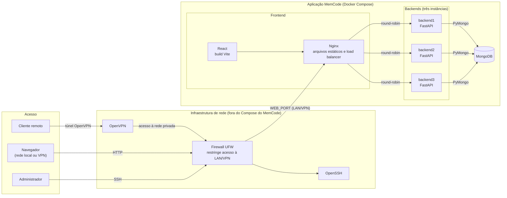
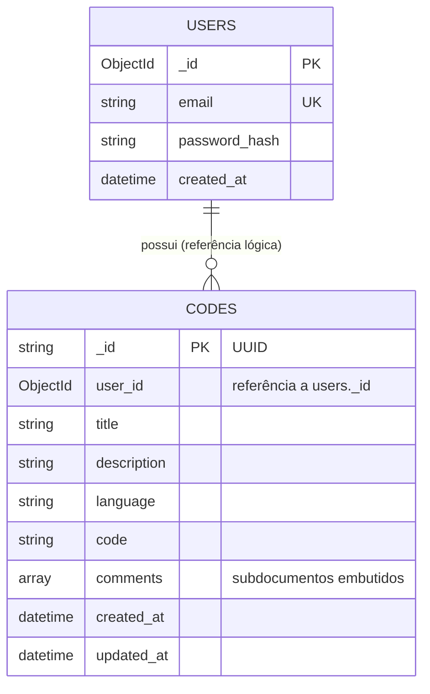

# MemCode

## Sobre o projeto

MemCode é uma aplicação web para desenvolvedores e estudantes de programação guardarem, organizarem e consultarem trechos de código, comandos, instruções e templates. Cada snippet pode ter título, descrição, linguagem, código e comentários. A busca permite encontrar snippets por título, descrição, linguagem ou conteúdo.

O acesso é feito por contas de usuário. A API autentica as sessões com JWT armazenado em cookie HttpOnly.

## Documentação dos componentes

- **Frontend:** [README do frontend](./frontend/README.md) — resumo da interface, configuração local e scripts npm.
- **Backend:** [README do backend](./backend/README.md) — resumo da API, modelo de dados, endpoints, configuração e testes.

## Arquitetura



O frontend deve ser acessível somente pela rede local ou por clientes conectados à VPN; conexões externas sem VPN não fazem parte do fluxo. O Compose publica `WEB_PORT`, mas não filtra os IPs de origem por si só. Essa restrição precisa ser aplicada nas regras de firewall da infraestrutura.

O Nginx serve a aplicação frontend e encaminha as chamadas em `/api` para três instâncias FastAPI (`backend1`, `backend2` e `backend3`), distribuindo-as em round-robin. O estado do upstream é compartilhado entre os workers do Nginx. As instâncias usam a mesma imagem e compartilham um único MongoDB. O Compose aguarda as três APIs ficarem saudáveis antes de iniciar o frontend.

OpenVPN, UFW, OpenSSH e FTP/SFTP são requisitos da camada de rede descrita no Escopo e no README do projeto Redes, mas não são iniciados pelo Compose do MemCode; dependem da configuração separada da infraestrutura.

## Modelo de dados do MongoDB

Cada usuário é armazenado em `users`. Seus snippets ficam em documentos separados na coleção `codes`, ligados pelo campo `user_id`. Os comentários são subdocumentos dentro de cada snippet, não uma coleção separada.



`email` tem índice único. A API armazena somente o hash da senha em `password_hash`, nunca a senha em texto puro. `codes._id` é um UUID em formato de string; `codes.user_id` guarda o `ObjectId` do usuário. Essa referência é lógica — o MongoDB não impõe uma chave estrangeira — e a API restringe as operações aos snippets pertencentes ao usuário autenticado. A coleção `codes` tem índice composto por `user_id` e `created_at` (ordem decrescente). Cada comentário embutido contém `id`, `text`, `created_at` e `updated_at`.

## Clonar, configurar e buildar

Pré-requisitos: Git, Docker Engine e Docker Compose v2. Clone o repositório e entre na pasta:

```sh
git clone https://github.com/xvierdev/memcode.git
cd memcode
```

Crie o arquivo de ambiente a partir do exemplo:

```sh
cp .env.example .env
openssl rand -hex 32
```

Copie o valor gerado para `SECRET_KEY` no `.env` e defina valores fortes para `MONGODB_USERNAME` e `MONGODB_PASSWORD`. Se necessário, ajuste `WEB_PORT` (porta web no host) e `MONGODB_HOST_PORT` (porta MongoDB no host) para evitar conflitos. Não compartilhe nem versione o `.env`.

Construa as imagens e inicie os serviços:

```sh
docker compose build
docker compose up -d
```

Confira o estado dos containers e acompanhe os logs das três instâncias:

```sh
docker compose ps
docker compose logs -f backend1 backend2 backend3
```

Acesse `http://<IP-ou-host-da-rede>:<WEB_PORT>` pelo navegador, estando na rede local ou conectado à VPN. O Compose publica a porta web, mas a restrição de acesso externo deve ser aplicada nas regras de firewall da infraestrutura. Para um teste simples da API via Nginx, execute no host:

```sh
curl -fsS http://localhost:80/api/health
```

Troque `80` pela porta definida em `WEB_PORT`. O Nginx distribui as requisições entre `backend1`, `backend2` e `backend3` em round-robin e tenta outro upstream se uma instância falhar. Para parar os serviços sem apagar os dados persistidos do MongoDB, execute `docker compose down` (não use `-v` se quiser manter o volume).

## Tecnologias

- **Frontend:** React, TypeScript, Vite, Tailwind CSS, Axios e React Router.
- **Backend:** Python, FastAPI, PyMongo, PyJWT e pwdlib com Argon2.
- **Banco de dados:** MongoDB.
- **Infraestrutura:** Docker, Docker Compose e Nginx.
- **Testes do backend:** pytest e mongomock.

## Professores e disciplinas

| Professor | Disciplina |
|---|---|
| Prof. Jean Costa | Redes de Computadores |
| Prof. Fernando Masanori | Laboratório de Banco de Dados |
