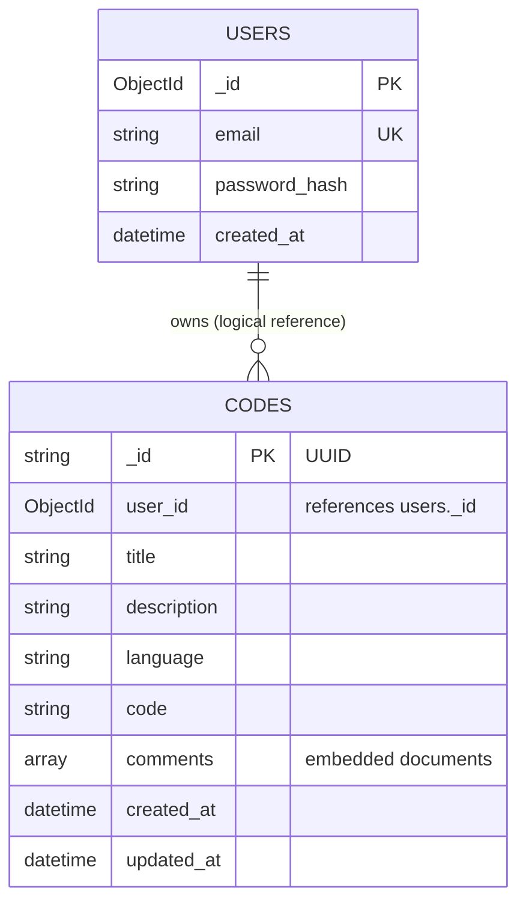

# Memcode API

API REST em FastAPI para cadastro e login com JWT e gerenciamento autenticado de snippets de código. Os usuários ficam na coleção `users`; cada snippet é um documento separado na coleção `codes`, com `user_id` referenciando seu dono. Os comentários permanecem embutidos no documento do snippet.

## Sumário

- [Arquitetura do banco](#arquitetura-do-banco)
- [Configuração e execução](#configuração-e-execução)
- [Endpoints](#endpoints)

## Arquitetura do banco



`codes._id` é um UUID e `codes.user_id` referencia `users._id`. A relação é consultada pelo índice composto `user_id`/`created_at`; a coleção `users` não mantém uma lista crescente de IDs de snippets. Cada snippet, incluindo sua lista de comentários, é um documento próprio e continua sujeito ao limite BSON de 16 MiB.

## Configuração e execução

1. Copie o exemplo raiz para `.env` e configure uma chave JWT:

   ```sh
   cp .env.example .env
   openssl rand -hex 32
   ```

   Coloque o valor gerado em `SECRET_KEY`. A API recusa chaves com menos de 32 bytes. Configure também `MONGODB_USERNAME` e `MONGODB_PASSWORD`; o Compose usa essas credenciais para inicializar o MongoDB e o backend para autenticar nele. `MONGODB_AUTH_SOURCE` deve ser `admin` para o usuário root criado pelo Compose. `backend/.env` é opcional e serve somente como fallback para configurações antigas.
2. Inicie MongoDB e as três instâncias da API:

   ```sh
   docker compose up -d --build mongodb backend1 backend2 backend3
   ```
3. Execute a API localmente a partir de `backend/` (MongoDB deve estar ativo). Antes, ajuste `MONGODB_URI` no `.env` para `mongodb://localhost:<MONGODB_HOST_PORT>`:

   ```sh
   cd backend
   uv run uvicorn src.main:app --reload
   ```

A execução local fica disponível em `http://localhost:8000`; o Swagger UI fica em `/docs` e o healthcheck em `/health`. A configuração compartilhada vem do `.env` na raiz; `backend/.env` é apenas um arquivo de fallback durante a transição. No desenvolvimento local, o frontend usa `frontend/.env` com `VITE_API_BASE_URL=http://localhost:8000`; no Compose, usa `/api` via proxy Nginx para o backend.

As variáveis `MONGO_INITDB_ROOT_USERNAME` e `MONGO_INITDB_ROOT_PASSWORD` só são aplicadas automaticamente quando o volume Mongo é inicializado pela primeira vez. Se o volume já contém dados, criar ou alterar usuários exige uma operação explícita no MongoDB; não remova o volume para reaplicar essas variáveis.

Para executar o frontend localmente, copie `frontend/.env.example` para `frontend/.env` e inicie Vite:

```sh
cd frontend
npm ci
npm run dev
```

Para executar a aplicação completa em containers, use `docker compose up --build`; o frontend usa `/api` via Nginx e o Compose encaminha as chamadas ao backend.

Para executar os testes do backend:

```sh
cd backend
uv run --group dev pytest
```

## Endpoints

| Método | Endpoint | Acesso | Descrição |
| --- | --- | --- | --- |
| `POST` | `/auth/register` | Público | Cria uma conta |
| `POST` | `/auth/login` | Público | Autentica e define um cookie de sessão HttpOnly |
| `POST` | `/auth/logout` | Público | Encerra a sessão removendo o cookie HttpOnly |
| `PATCH` | `/auth/password` | Cookie/JWT | Altera a senha |
| `POST` | `/codes` | Cookie/JWT | Adiciona um snippet |
| `GET` | `/codes` | Cookie/JWT | Lista os snippets do usuário |
| `GET` | `/codes/search` | Cookie/JWT | Busca snippets com filtros |
| `GET` | `/codes/{code_id}` | Cookie/JWT | Consulta um snippet |
| `PUT` | `/codes/{code_id}` | Cookie/JWT | Atualiza um snippet |
| `POST` | `/codes/{code_id}/comments` | Cookie/JWT | Adiciona comentário a um snippet existente |
| `PATCH` | `/codes/{code_id}/comments/{comment_id}` | Cookie/JWT | Edita um comentário |
| `DELETE` | `/codes/{code_id}/comments/{comment_id}` | Cookie/JWT | Remove um comentário |
| `DELETE` | `/codes/{code_id}` | Cookie/JWT | Remove um snippet após confirmar a senha atual |

Após o login, a API define um cookie HttpOnly `memcode_access_token` e não expõe o JWT no corpo da resposta. O navegador envia o cookie automaticamente às rotas protegidas. O Swagger, aberto no mesmo host da API, também usa o cookie do navegador. Defina `AUTH_COOKIE_SECURE=true` quando a aplicação estiver servida por HTTPS.

O logout remove o cookie do navegador. Como o JWT é stateless, isso não revoga uma cópia do token obtida fora do navegador; ela permanece válida até expirar.

Na busca, informe pelo menos um parâmetro entre `title`, `description`, `language` e `code`. Os filtros de título, descrição e conteúdo procuram trechos sem diferenciar maiúsculas de minúsculas; `language` compara o nome completo da linguagem sem diferenciar maiúsculas de minúsculas. Quando mais de um parâmetro é informado, todos precisam corresponder ao snippet. Exemplo: `/codes/search?title=python&language=Python`.

Cada snippet tem `title`, `description`, `language`, `code` e `comments`. Um snippet novo sempre começa sem comentários; comentários são adicionados depois, pelas rotas de comentários. Cada comentário contém `id`, `text`, `created_at` e `updated_at`, e a lista é retornada do mais recente para o mais antigo. Os campos do snippet `id`, `created_at` e `updated_at` são gerados pela API. Comentários legados armazenados como texto são retornados no formato estruturado, com timestamp aproximado baseado na última atualização do snippet. A coleção separada remove o limite acumulado por usuário; cada documento de snippet continua sujeito ao limite BSON do MongoDB (16 MiB), inclusive seus comentários.

A exclusão exige o corpo JSON `{"password": "senha-atual"}` além da sessão autenticada. A API valida a senha antes de remover o snippet.