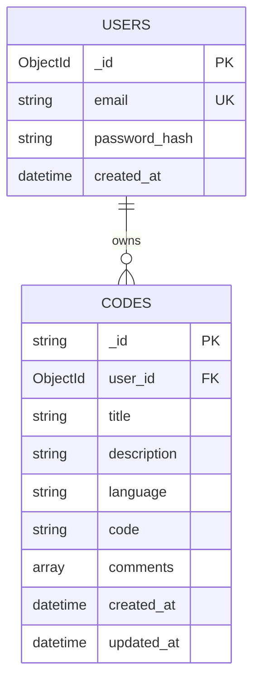

# Memcode API

API REST em FastAPI para cadastro e login com JWT e gerenciamento autenticado de snippets de código. Os usuários ficam na coleção `users`; cada snippet é um documento separado na coleção `codes`, com `user_id` referenciando seu dono. Os comentários permanecem embutidos no documento do snippet.

## Arquitetura do banco



`codes._id` é um UUID e `codes.user_id` referencia `users._id`. A relação é consultada pelo índice composto `user_id`/`created_at`; a coleção `users` não mantém uma lista crescente de IDs de snippets. Cada snippet, incluindo sua lista de comentários, é um documento próprio e continua sujeito ao limite BSON de 16 MiB.

## Configuração e execução

1. Copie os exemplos de ambiente para `.env` e configure uma chave JWT:

   ```sh
   cp .env.example .env
   cp backend/.env.example backend/.env
   openssl rand -hex 32
   ```

   Coloque o valor gerado em `SECRET_KEY`. A API recusa chaves com menos de 32 bytes. Portas e porta publicada do MongoDB ficam no `.env` da raiz; URI, timeout, banco e origens CORS ficam no `.env` do backend.
2. Inicie o MongoDB:

   ```sh
   docker compose up -d mongodb
   ```
3. Execute a API localmente a partir de `backend/`:

   ```sh
   cd backend
   uv run uvicorn src.main:app --reload
   ```

A execução local fica disponível em `http://localhost:8000`; o Swagger UI fica em `/docs` e o healthcheck em `/health`. Via Compose, a porta pública vem de `API_PORT` no `.env` da raiz do projeto. O MongoDB local usa `mongodb://localhost:27017`, configurado no `.env` do backend.

Na raiz do repositório, para executar a API pelo Compose, use `docker compose up --build backend`; o Compose aponta o container da API para o serviço `mongodb` na rede privada.

Para executar os testes do backend:

```sh
cd backend
uv run --group dev pytest
```

## Endpoints

| Método | Endpoint | Acesso | Descrição |
| --- | --- | --- | --- |
| `POST` | `/auth/register` | Público | Cria uma conta |
| `POST` | `/auth/login` | Público | Autentica e retorna um token Bearer |
| `PATCH` | `/auth/password` | JWT | Altera a senha |
| `POST` | `/codes` | JWT | Adiciona um snippet |
| `GET` | `/codes` | JWT | Lista os snippets do usuário |
| `GET` | `/codes/search` | JWT | Busca snippets com filtros |
| `GET` | `/codes/{code_id}` | JWT | Consulta um snippet |
| `PUT` | `/codes/{code_id}` | JWT | Atualiza um snippet |
| `DELETE` | `/codes/{code_id}` | JWT | Remove um snippet |

Após o login, use o token no botão **Authorize** do Swagger UI.

Na busca, informe pelo menos um parâmetro entre `title`, `description`, `language` e `code`. Os filtros de título, descrição e conteúdo procuram trechos sem diferenciar maiúsculas de minúsculas; `language` compara o nome completo da linguagem sem diferenciar maiúsculas de minúsculas. Quando mais de um parâmetro é informado, todos precisam corresponder ao snippet. Exemplo: `/codes/search?title=python&language=Python`.

Cada snippet tem `title`, `description`, `language`, `code` e `comments`. Os campos `id`, `created_at` e `updated_at` são gerados pela API. A coleção separada remove o limite acumulado por usuário; cada documento de snippet continua sujeito ao limite BSON do MongoDB (16 MiB), inclusive seus comentários.